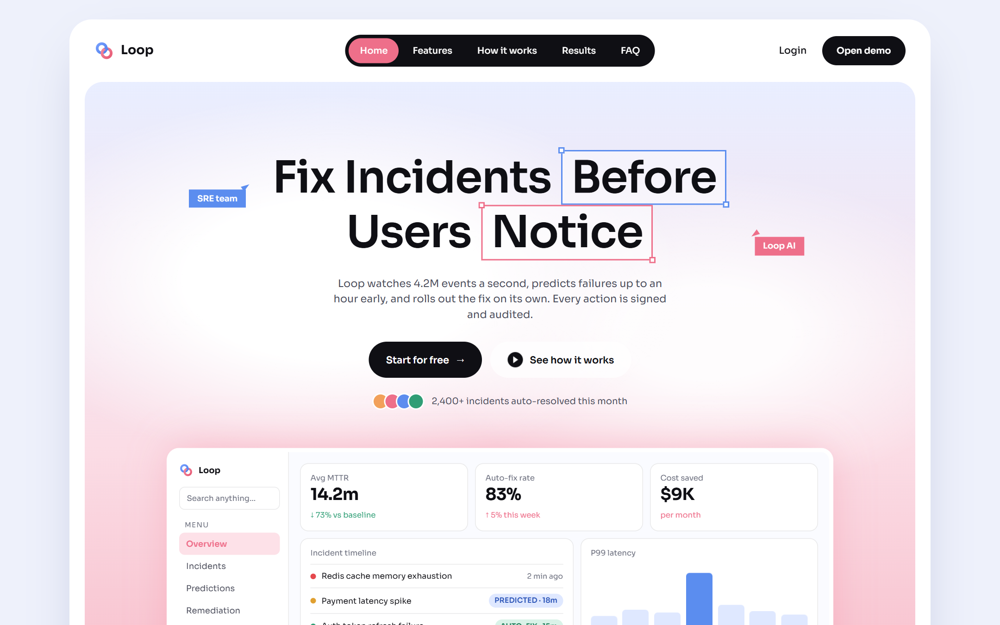
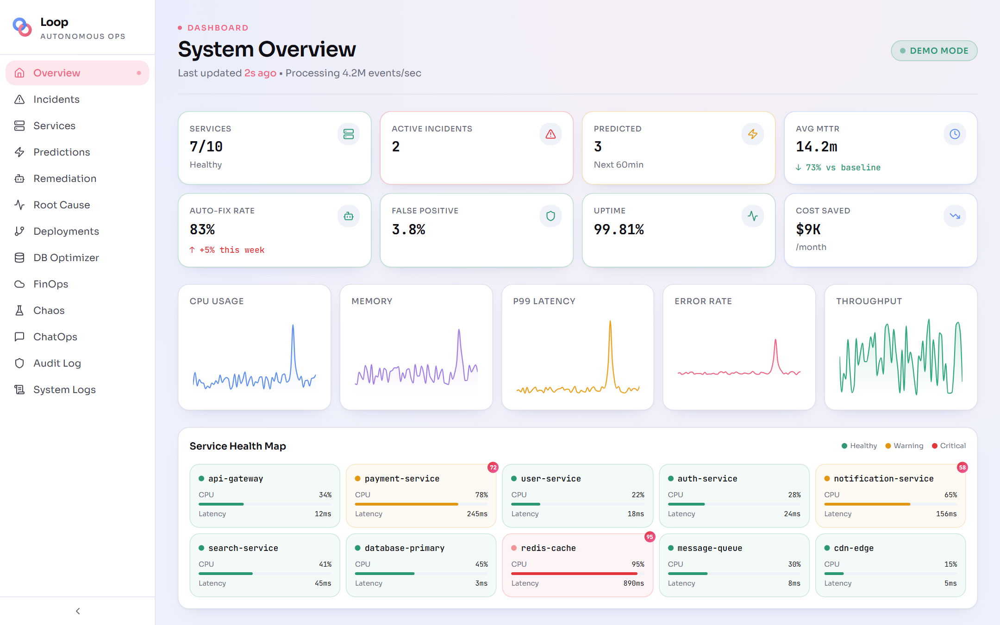
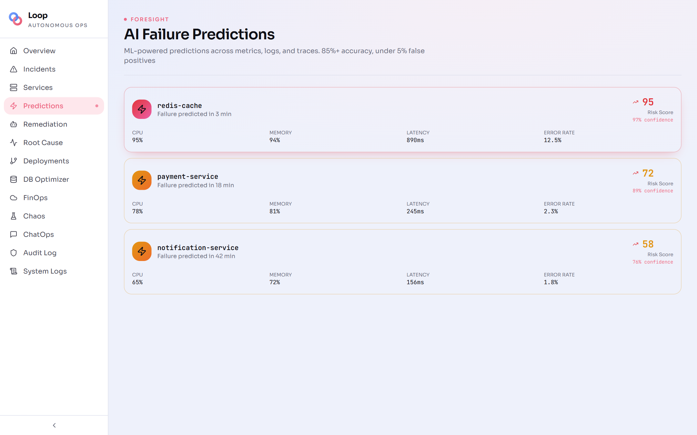

<div align="center">


# Loop

**Autonomous SRE and DevOps platform for cloud infrastructure monitoring and incident orchestration.**

<a href="https://loopsre.vercel.app"></a>
<a href="https://loopsre.vercel.app/overview"></a>

<br/>



</div>

## 📸 Screenshots

<table>
  <tr>
    <td></td>
    <td></td>
  </tr>
  <tr>
    <td align="center"><sub>System overview</sub></td>
    <td align="center"><sub>AI failure predictions</sub></td>
  </tr>
</table>

## 🚀 Vision

Production systems face 200+ incidents monthly with significant business impact. Loop transforms traditional monitoring into an autonomous operation that predicts failures before they affect users, automatically implements corrective actions, and provides deep root cause insights.

## ✨ Key Features

### 🔮 Predictive Intelligence
- **Failure Prediction**: Predicts system failures 30-60 minutes in advance with **85% accuracy**.
- **Anomaly Detection**: Real-time cross-referencing of logs, metrics, and traces to identify emerging risks.

### 🤖 Autonomous Remediation
- **Self-Healing**: Automatically executes service restarts, traffic rerouting, and resource scaling.
- **Auto-Correction**: High success rate (>80%) in remediating known failure patterns without manual tickets.

### 🔍 Intelligent Root Cause Analysis (RCA)
- **Code-Level Awareness**: Identifies the exact failing component and links it to specific code commits.
- **Trace Visualization**: Full-stack visibility across distributed services.

### 💰 FinOps & Performance Optimization
- **AI Cost Control**: Automatically shuts down unused instances and rightsizes workloads to maximize cloud ROI.
- **DB Optimizer**: Detects and auto-optimizes slow queries and missing indexes based on execution patterns.

### 🛡️ Resilience & Compliance
- **Continuous Chaos**: Continuous chaos engineering tests (Pod kills, latency injection) to harden system resilience.
- **Audit Logs**: Immutable, blockchain-verified change logs for high-security compliance environments.
- **Progressive Delivery**: Automated deployment with interactive progressive rollouts and instant rollback.

### 💬 ChatOps
- **Human-in-the-Loop**: Integrated ChatOps interface for real-time human oversight and collaborative troubleshooting.

## 🛠️ Technical Stack

- **Frontend**: React (Vite, TypeScript)
- **UI System**: shadcn/ui, Tailwind CSS, Framer Motion
- **Monitoring & Viz**: Recharts, Lucide Icons
- **Simulation**: Context-based system state engine

## 🏁 Getting Started

### Prerequisites
- [Node.js](https://nodejs.org/) (v18+)
- [npm](https://www.npmjs.com/) or [Bun](https://bun.sh/)

### Installation

1.  **Clone the repository**
    ```sh
    git clone https://github.com/WillyEverGreen/Loop_1.0.git
    cd Loop_1.0
    ```

2.  **Install dependencies**
    ```sh
    npm install
    ```

3.  **Start development server**
    ```sh
    npm run dev
    ```

    The landing page is served at `/` and the dashboard at `/overview`.

## 📊 Performance Targets

| Metric | Target |
| :--- | :--- |
| **Failure Prediction Accuracy** | >85% |
| **Lead Time to Failure** | 45+ Minutes |
| **MTTR Reduction** | 4 hours → 15 minutes |
| **False Positive Rate** | <5% |
| **Throughput** | 10M events per second |

---

Built for the future of Autonomous Operations. 🔄